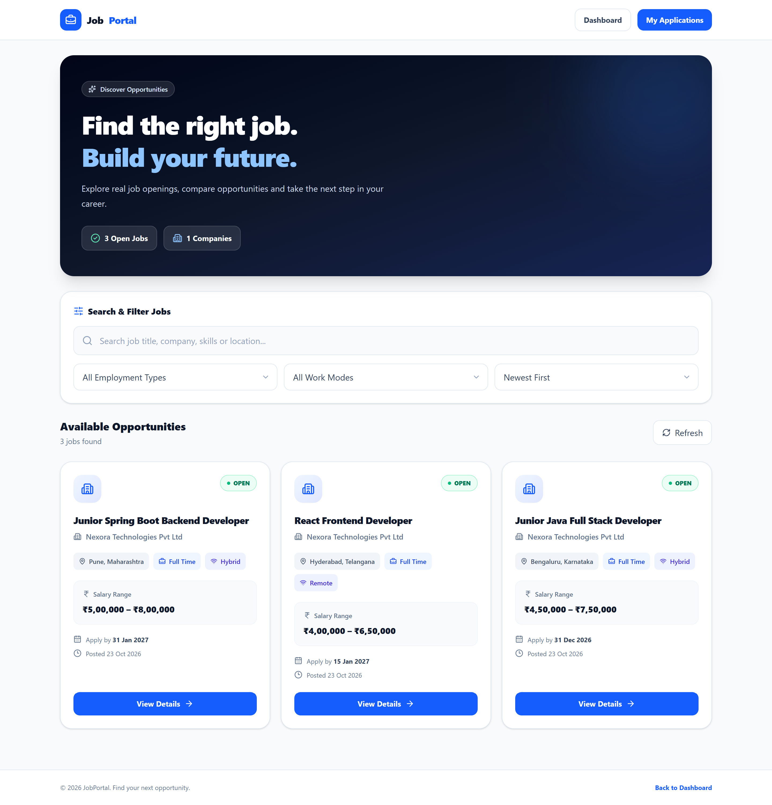
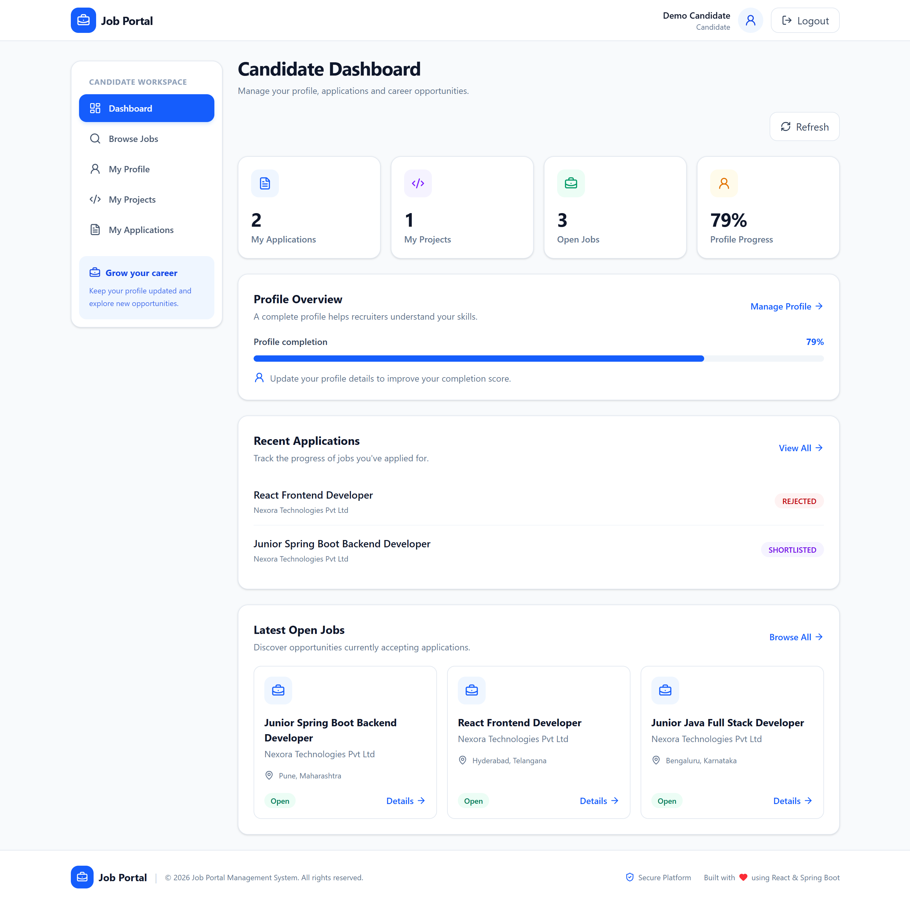
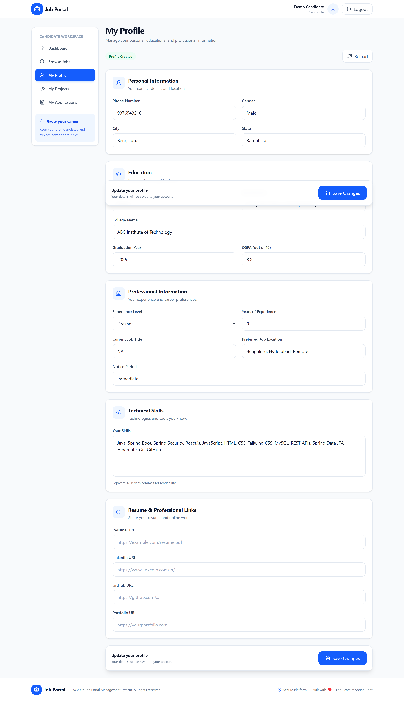
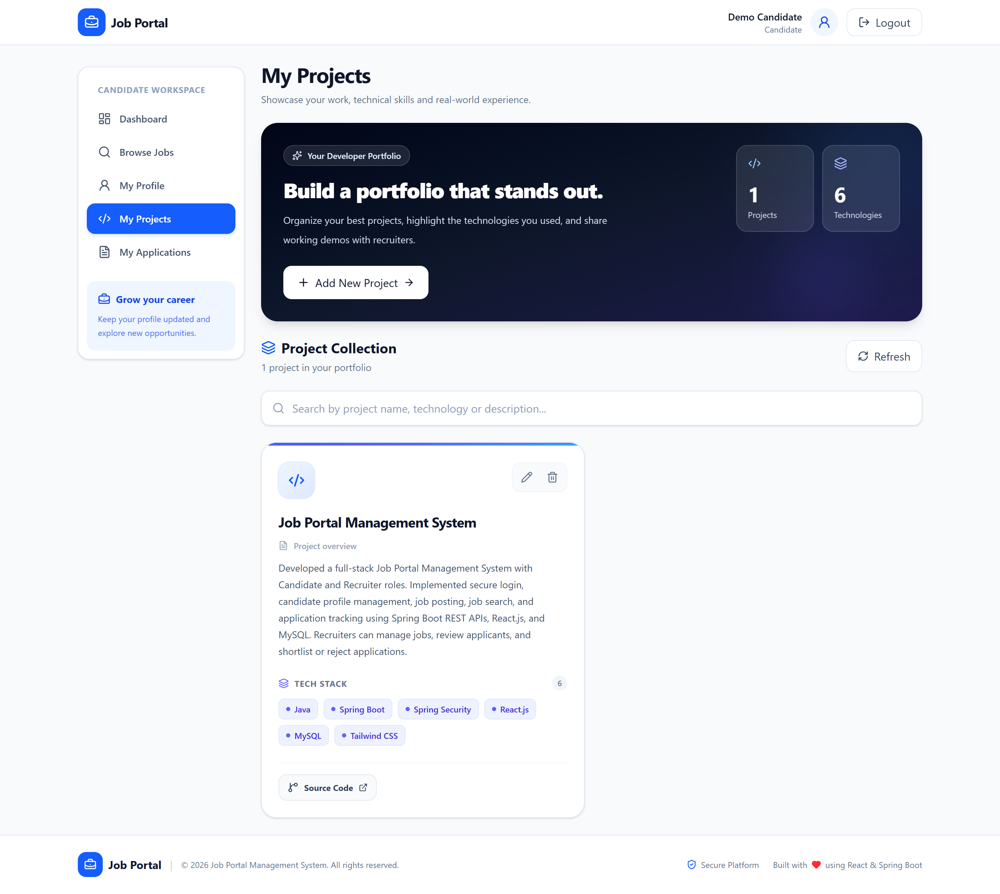
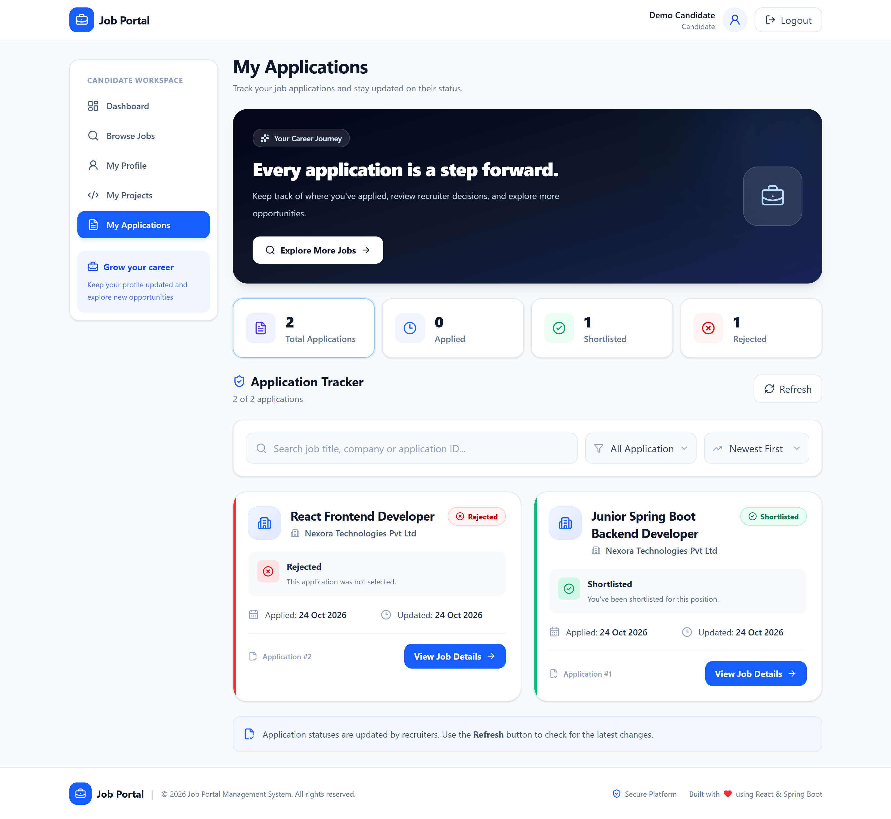
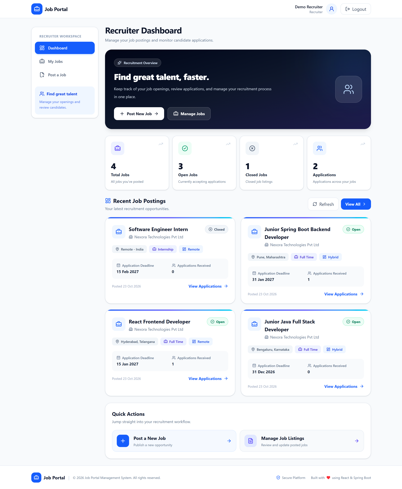
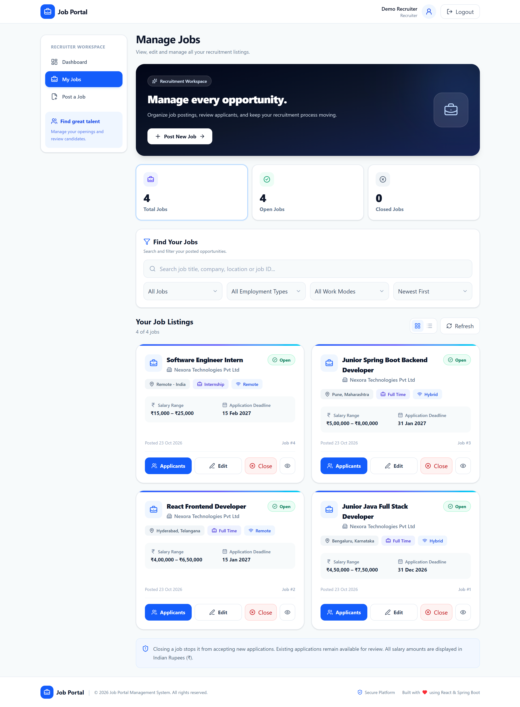
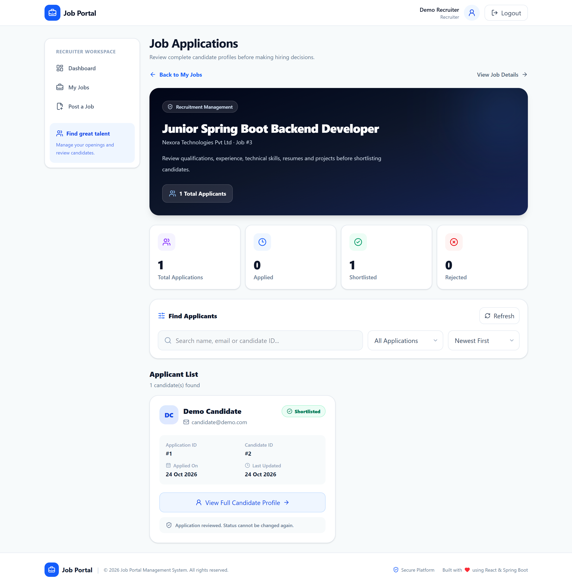

# Job Portal Management System

A full-stack Job Portal Management System built using **Java, Spring Boot, React.js, and MySQL**. The application provides separate Candidate and Recruiter workflows for managing job postings and applications.

## Tech Stack

**Backend:** Java 21, Spring Boot, Spring Security, Spring Data JPA, Hibernate, REST APIs

**Frontend:** React.js, JavaScript, Tailwind CSS, React Router, Vite

**Database:** MySQL

**Tools:** Git, GitHub, Maven, Postman

## Key Features

### Candidate
- Register and log in securely.
- Create and update a candidate profile.
- Add, edit, and delete personal projects.
- Browse and search available jobs.
- View job details and apply for jobs.
- Track application status: Applied, Shortlisted, or Rejected.

### Recruiter
- Register and log in securely.
- Create, edit, and close job postings.
- View applications received for posted jobs.
- Review candidate profiles and project details.
- Shortlist or reject job applications.

### Security
- Session-based authentication using Spring Security.
- Role-based authorization for Candidate and Recruiter.
- CSRF protection for authenticated requests.
- Backend validation and prevention of duplicate job applications.

## Project Structure

```text
job-portal/
├── backend/
│   ├── src/
│   ├── pom.xml
│   └── mvnw
├── frontend/
│   ├── src/
│   ├── package.json
│   └── vite.config.js
├── .gitignore
└── README.md
```


## Application Screenshots

### 1. Browse Jobs


### 2. Candidate Dashboard


### 3. Candidate Profile


### 4. Candidate Projects


### 5. Candidate Applications


### 6. Recruiter Dashboard


### 7. Recruiter Job Management


### 8. Recruiter Applications



## Database Design

The application uses MySQL with five main tables:

| Table | Purpose |
|---|---|
| `users` | Stores user accounts and roles |
| `candidate_profiles` | Stores candidate information |
| `candidate_projects` | Stores candidate projects |
| `jobs` | Stores recruiter job postings |
| `applications` | Stores job applications and statuses |

## Run Locally

### Prerequisites

- Java 21
- Maven or Maven Wrapper
- Node.js and npm
- MySQL


### 1. Database Setup

Make sure MySQL is installed and running.

Create the database:

```sql
CREATE DATABASE job_portal_db;
```

Import the database schema using MySQL Workbench:

1. Open MySQL Workbench.
2. Connect to your MySQL server.
3. Open `database/schema.sql`.
4. Execute the SQL script.

Alternatively, import using the MySQL command line:

```bash
mysql -u root -p job_portal_db < database/schema.sql
```

The schema creates the required tables:

- `users`
- `candidate_profiles`
- `candidate_projects`
- `jobs`
- `applications`

**Note:** The backend uses `spring.jpa.hibernate.ddl-auto: validate`, so database tables must exist before starting the application.


### 2. Backend Setup

Configure the following environment variables:

```text
DB_USERNAME=your_mysql_username
DB_PASSWORD=your_mysql_password
```

Navigate to the backend directory:

```bash
cd backend
```

Run the Spring Boot application on Windows:

```bash
mvnw.cmd spring-boot:run
```

The backend runs at `http://localhost:8080`.

### 3. Frontend Setup

Open another terminal and navigate to the frontend directory:

```bash
cd frontend
```

Install dependencies:

```bash
npm install
```

Start the development server:

```bash
npm run dev
```

Open `http://localhost:5173` in your browser.

## Application Workflow

1. A user registers as a Candidate or Recruiter.
2. A Recruiter creates and manages job postings.
3. A Candidate searches for available jobs and submits applications.
4. The Recruiter reviews applicants and updates their application status.
5. The Candidate can track application updates from their dashboard.

## Future Enhancements

- Admin dashboard
- Recruiter company profiles
- Resume file uploads
- Email notifications
- Application deployment

## Author

Developed as a full-stack portfolio project to demonstrate Java, Spring Boot, React.js, MySQL, REST API development, and role-based authentication.